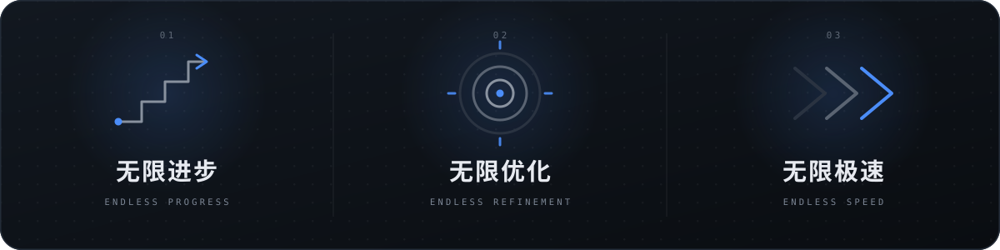
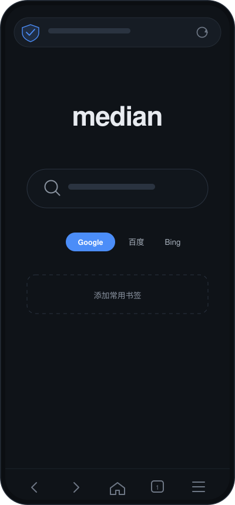
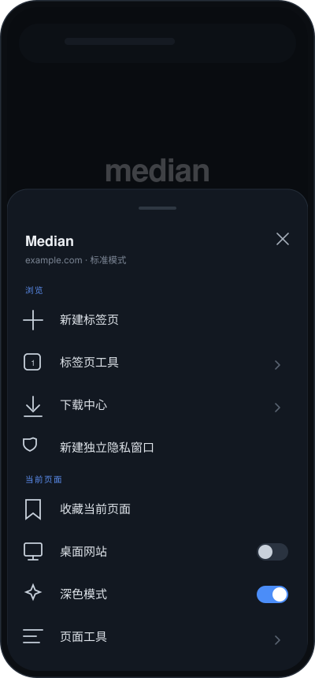
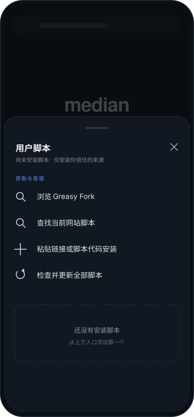

<div align="center">


<h1>Median Browser</h1>

<p><strong>无限进步，无限优化，无限极速</strong></p>

<p>基于 Android System WebView 的轻量浏览器<br>
广告过滤 · 本地密码库 · 用户脚本 · 离线阅读</p>

<p>
  <a href="https://github.com/bi-box/Median/releases/tag/2.4.0">
    
  </a>
</p>

<p>
  
  
  
  
</p>

<p>
  <a href="https://t.me/MedianBeta">💬 加入 Telegram 社区</a>
  &nbsp;·&nbsp;
  <a href="https://github.com/bi-box/Median/issues">🐞 问题反馈</a>
</p>

<sub><a href="#设计哲学">设计哲学</a> &nbsp;·&nbsp; <a href="#核心功能">核心功能</a> &nbsp;·&nbsp; <a href="#界面预览">界面预览</a> &nbsp;·&nbsp; <a href="#立即安装">立即安装</a> &nbsp;·&nbsp; <a href="#隐私与安全">隐私与安全</a> &nbsp;·&nbsp; <a href="#常见问题">常见问题</a> &nbsp;·&nbsp; <a href="#开发者">开发者</a></sub>

</div>

---

## 一个浏览器，只做你需要的事

Median 用设备自带的 **Android System WebView** 渲染网页，因此应用本身可以保持得很小；广告过滤、密码管理、用户脚本、下载与离线阅读都在应用内完成，不必再装插件。书签、历史、密码等数据默认留在本机，备份文件由你自己保管。

## 设计哲学



- **无限进步** —— 没有「做完了」的版本：主菜单、页面恢复、过滤引擎、脚本 API，每一版都在修上一版的粗糙处，改动全部公开在[更新记录](CHANGELOG.md)里。
- **无限优化** —— 单 APK 约 300 KB，不打包私有内核；网络拦截、启动与数据加载在关键路径上反复打磨，能少做的事就不做。
- **无限极速** —— 把等待留给网络，而不是应用本身：渲染交给系统 WebView，交互与导航尽量直接，不让外壳拖慢页面。

## 核心功能

<table>
<tr>
<td width="50%" valign="top">

<h3>🛡️ 广告过滤</h3>

**减少页面干扰，让内容更清楚。**

支持 ABP / hosts 规则、过滤订阅、逐站点开关和页面元素隐藏。你可以自行挑选规则列表，也可以按网站调整过滤状态。

</td>
<td width="50%" valign="top">

<h3>🔐 本地密码库</h3>

**常用账号，安全地留在自己的设备上。**

密码库由 Android Keystore 与 AES-GCM 保护，支持 HTTPS 页面自动填充、保存提示和加密备份；备份口令由你设置。

</td>
</tr>
<tr>
<td width="50%" valign="top">

<h3>🧩 用户脚本</h3>

**按自己的习惯增强网页。**

支持用户脚本与常用 GM / GM4 API，可按网站匹配运行，并对特权网络请求的授权范围做检查。第三方脚本请从可信来源安装。

</td>
<td width="50%" valign="top">

<h3>📥 下载与离线阅读</h3>

**想看的内容，留给稍后。**

下载中心支持暂停、继续与断点续传；网页可保存为本地离线页面，并提供阅读模式、系统朗读、网页翻译和页内查找。

</td>
</tr>
<tr>
<td width="50%" valign="top">

<h3>🕶️ 独立隐私窗口</h3>

**需要清静时，切换到独立会话。**

隐私窗口与普通浏览会话彼此隔离，退出时清理本地会话数据。它隔离的是设备上的浏览数据，不是匿名网络通道。

</td>
<td width="50%" valign="top">

<h3>🎛️ 主页与标签自定义</h3>

**让浏览方式贴合自己的习惯。**

可调整主页背景、布局、搜索入口与常用网站，配合标签管理、主题切换、逐站点权限和边缘滑动导航，拼出顺手的操作方式。

</td>
</tr>
</table>

## 界面预览

<table>
<tr>
<td align="center" width="33%" valign="top">

<br>
<sub><strong>起始页</strong> · 搜索入口与常用网站</sub>
</td>
<td align="center" width="33%" valign="top">

<br>
<sub><strong>主菜单</strong> · 浏览、页面工具与设置</sub>
</td>
<td align="center" width="33%" valign="top">

<br>
<sub><strong>用户脚本</strong> · 安装、匹配与更新</sub>
</td>
</tr>
</table>

<sub>以上为代码绘制的界面示意图，用于说明布局结构，细节以应用内实际效果为准。</sub>

## 立即安装

<p>
  <a href="https://github.com/bi-box/Median/releases/tag/2.4.0"><strong>⬇ 下载 Median Browser 2.4.0（单 APK）</strong></a>
</p>

1. 下载 `MedianBrowser-2.4.0.apk`。
2. 首次侧载时，按 Android 提示允许当前应用「安装未知应用」。
3. 打开 APK，确认安装，完成后即可启动。

| 项目 | 信息 |
|---|---|
| 版本 | 2.4.0（versionCode 103） |
| 安装包 | `MedianBrowser-2.4.0.apk`，SHA-256 见[开发者](#开发者) |
| 包名 | `com.xinyv.median.compat` |
| 最低系统 | Android 8.0（API 26）；隐私窗口需 Android 9.0（API 28） |
| 网页引擎 | 设备提供的 Android System WebView |
| 升级 | 与既有正式版同签名，可覆盖安装 |

> [!IMPORTANT]
> 网页兼容性与安全补丁取决于设备的 System WebView，建议保持系统和 WebView 更新。从旧版升级前，先用浏览器内的备份功能导出重要数据。

## 隐私与安全

<table>
<tr>
<td width="50%" valign="top">

<h3>默认保存在设备上</h3>

书签、历史、密码、脚本、下载记录、过滤规则和离线页面默认写入本机。密码库由 Android Keystore 与 AES-GCM 保护。

</td>
<td width="50%" valign="top">

<h3>网络请求由你发起</h3>

浏览、搜索、翻译、更新订阅、安装脚本或下载文件时，Median 会连接对应站点。应用没有广告、分析或崩溃遥测 SDK，也没有开发者运营的账号与同步服务器。

</td>
</tr>
</table>

> [!WARNING]
> 隐私窗口不是 VPN，也不提供匿名网络：你访问的网站与所在网络仍能看到正常的网络连接。用户脚本可能读取其匹配网站上的内容，请谨慎选择来源。

完整说明见[隐私政策](PRIVACY_POLICY.md)与[安全策略](SECURITY.md)。

## 常见问题

### 使用

<details>
<summary><strong>Median 支持哪些 Android 版本？</strong></summary>

最低支持 Android 8.0（API 26）。独立隐私窗口需要 Android 9.0（API 28）或更新版本。

</details>

<details>
<summary><strong>下载后怎么安装？</strong></summary>

打开下载的 APK，按 Android 安装器提示，允许你下载 APK 所用的应用「安装未知应用」，然后确认安装。

</details>

<details>
<summary><strong>能从旧版本直接覆盖升级吗？</strong></summary>

可以，但包名与签名需要与已安装版本一致。若已安装的版本来自其他渠道（例如测试包），通常无法覆盖，需要先卸载；卸载会清除本机数据，请先导出备份。

</details>

<details>
<summary><strong>广告过滤的效果如何？</strong></summary>

支持 ABP / hosts 规则、过滤订阅、逐站点控制和页面元素隐藏。实际效果取决于所选规则列表与网站实现，个别广告或页面功能可能仍需手动处理。

</details>

<details>
<summary><strong>支持 Tampermonkey 用户脚本吗？</strong></summary>

支持用户脚本与常用 GM / GM4 API，包括脚本值、菜单和网络请求等能力。不同脚本用到的 API 不同，无法保证兼容所有桌面扩展；安装前请检查来源与权限。

</details>

### 隐私与数据

<details>
<summary><strong>密码保存在哪里？</strong></summary>

保存在本机的加密密码库中，由 Android Keystore 与 AES-GCM 保护，不会上传到任何开发者服务器。备份文件由你自行保管，口令丢失后无法恢复。

</details>

<details>
<summary><strong>隐私窗口会让我在网上匿名吗？</strong></summary>

不会。隐私窗口隔离并清理本机会话数据，但访问网站时仍会产生网络连接；它不是 VPN，也不隐藏网络地址。

</details>

<details>
<summary><strong>Median 会收集使用数据吗？</strong></summary>

应用不包含广告、分析或崩溃遥测 SDK。你在浏览、搜索、翻译或更新订阅时产生的请求会直接发往对应网站或服务，受其隐私政策约束。

</details>

### 项目

<details>
<summary><strong>Median 是开源软件吗？</strong></summary>

是。项目以 **GNU General Public License v3.0（GPL-3.0）** 发布：可以自由使用、修改和分发，包括商用；但分发衍生作品时须同样以 GPL-3.0 开源，并保留版权与许可声明。完整条款见 [LICENSE](LICENSE)。

</details>

<details>
<summary><strong>在哪里交流、反馈问题或报告安全漏洞？</strong></summary>

- **Telegram 社区**：[t.me/MedianBeta](https://t.me/MedianBeta)，日常交流、版本试用与使用问题。
- **GitHub Issues**：[提交问题或功能建议](https://github.com/bi-box/Median/issues)。
- **安全漏洞**：请阅读[安全策略](SECURITY.md)，不要在公开渠道提交密码、Cookie、私钥或其他个人数据。

</details>

## 开发者

### 技术选型

| 项目 | 信息 |
|---|---|
| 平台 | Android 8.0+，compileSdk / targetSdk 36 |
| 网页渲染 | Android System WebView 与 WebKit 兼容接口 |
| 主要语言 | Java 17 |
| 构建工具 | Gradle、Android Gradle Plugin |
| 数据保护 | Android Keystore、AES-GCM；备份使用用户设置的密码 |

### 本地构建

需要 JDK 17 与 Android SDK 36。生成可覆盖正式安装的 APK 需要正式签名配置；签名私钥与密码不得提交到仓库。

**Windows**

```powershell
.\gradlew.bat lintRelease testReleaseUnitTest assembleRelease
```

**macOS / Linux**

```bash
./gradlew lintRelease testReleaseUnitTest assembleRelease
```

Release 附件只上传 `MedianBrowser-2.4.0.apk`，SHA-256：

```text
833AD242C1F2EDA23475767CE9D8A81E51D186D1C9A37F6B3E9B529E07486D50
```

### 项目文档

- [版本更新记录](CHANGELOG.md)
- [隐私政策](PRIVACY_POLICY.md)
- [安全策略](SECURITY.md)
- [第三方组件声明](THIRD_PARTY_NOTICES.md)
- [版权与许可声明](NOTICE)
- [软件许可](LICENSE)

### 许可

Median Browser 以 [GNU General Public License v3.0](LICENSE) 发布，可自由使用、修改与分发；再分发时需以同一协议开放源码并保留版权声明。随源码打包的第三方组件保留其原始许可（Apache-2.0、BSD-style、EPL 等），详见[第三方组件声明](THIRD_PARTY_NOTICES.md)。

<div align="center">

<br>

<sub>Median Browser · 无限进步，无限优化，无限极速</sub>

<sub><a href="https://github.com/bi-box/Median">项目主页</a> &nbsp;·&nbsp; <a href="https://github.com/bi-box/Median/releases">版本发布</a> &nbsp;·&nbsp; <a href="https://t.me/MedianBeta">Telegram 社区</a> &nbsp;·&nbsp; <a href="https://github.com/bi-box/Median/issues">问题反馈</a> &nbsp;·&nbsp; <a href="LICENSE">许可</a></sub>

</div>
